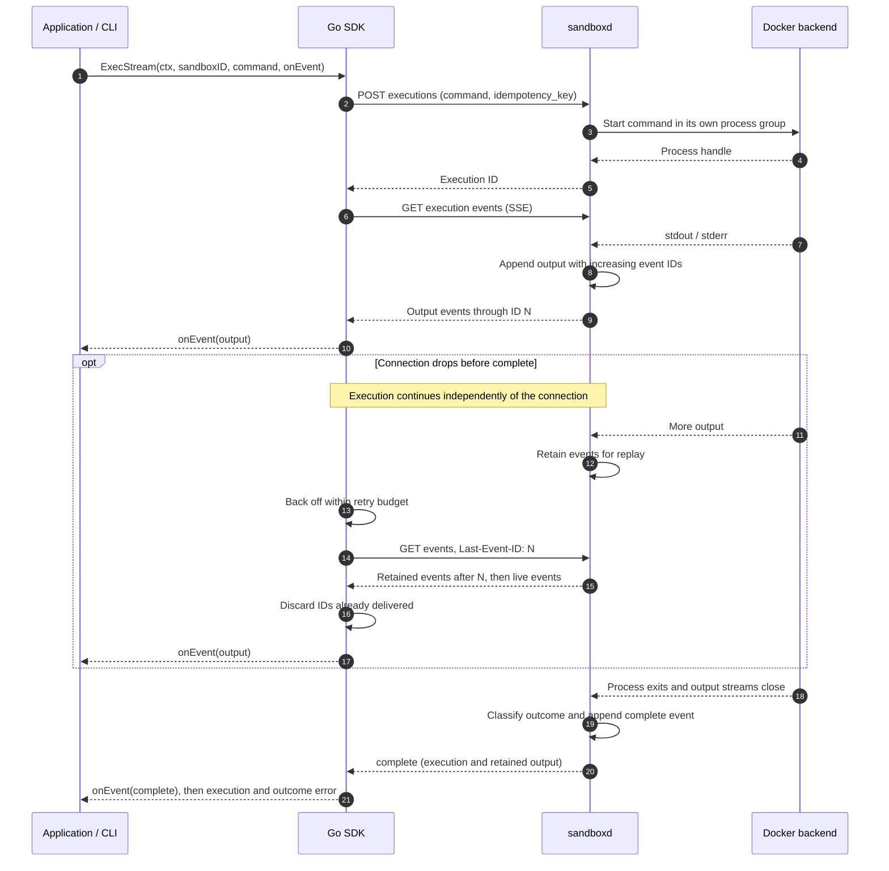
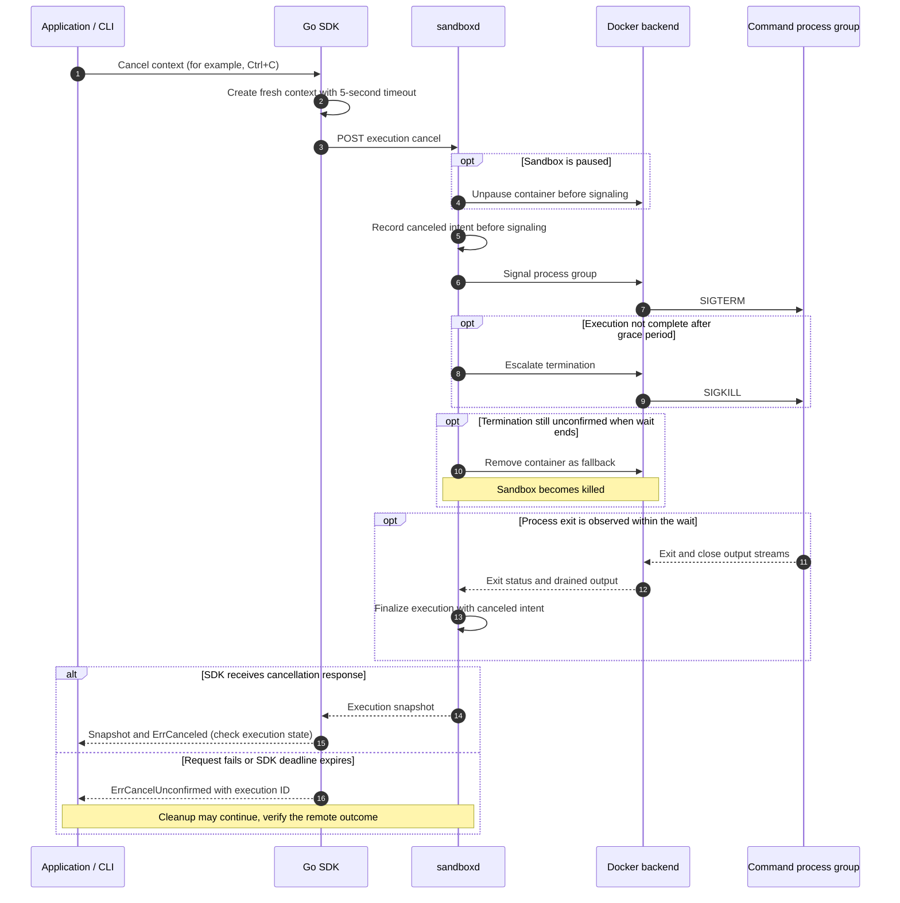

# Design

tiny-sandbox provides Docker-backed code execution for AI agents through a Go SDK, CLI, and HTTP API. It uses in-memory state and does not provide hardened isolation or multi-tenant access controls.

This document is the design source for the implementation. `api.md`, `sdk.md` and `cli.md` are normative contracts; where this document disagrees with them, they win.

## Motivation

Coding agents increasingly run the code they write. Running that code is easy; running it predictably is not. Most of the hard questions sit on the client side of the API:

- When a sandbox "times out", is it destroyed or paused, and what does a pause actually keep?
- If a streaming connection drops, does the command keep running? Can the client resume without losing or duplicating output?
- When the caller cancels, does the process really stop, including its children?
- A command exited with 137. Was it an OOM kill, a timeout, a cancellation, or an external eviction?
- Which requests are safe to retry, and how does a retry avoid running a command twice?

The module is `github.com/ruhuang2001/tiny-sandbox`; `sandbox-go` is the package `sandbox` inside it, so SDK imports read `github.com/ruhuang2001/tiny-sandbox/sandbox-go`.

This project answers those questions with working code and tests rather than prose. The API semantics follow the public documentation of PPIO Sandbox and E2B where they agree; it does not claim wire compatibility with either.

## Goals

1. **Lifecycle**: create, pause, resume, and kill sandboxes; a lifetime timeout and an idle timeout, each able to kill or pause.
2. **Execution and streaming**: executions as resources with IDs, output over SSE, lossless reconnect with `Last-Event-ID`, and command-level cancellation.
3. **Errors and retries**: five typed termination reasons and a retry policy that never replays a command.
4. **Developer experience**: a CLI that gets a new user from zero to a first command and helps debug a failing one.

## Non-goals

Templates, snapshots, volumes, secrets, multi-tenancy, billing, browser automation, non-Go SDKs, durable server state, and hardened isolation (microVMs, gVisor). Each has an extension point and a design sketch in [future.md](future.md).

## Architecture

```text
sandboxctl / Go application
          |
      sandbox-go          HTTP JSON + SSE
          |
       sandboxd
          |
   daemon.Backend  ---- in-memory backend (unit and contract tests)
          |
   Docker Engine API over a unix socket
          |
   one container per sandbox
```

The daemon depends on a `Backend` interface rather than Docker. `dockerbackend` implements that interface using `dockerapi`, which handles the Docker Engine HTTP protocol. `sandboxd` wires these packages together; the SDK uses the public HTTP API. The CLI uses the SDK, with direct health and local Docker checks in `doctor`.

```
cmd/sandboxd/            main, flags, wiring
cmd/sandboxctl/          one file per command group: run, doctor, ops, main
internal/daemon/         state machine, execution engine, classification, HTTP handlers
internal/dockerapi/      minimal Engine API client: create, start, exec, inspect, pause, kill
internal/dockerbackend/  Backend implementation over dockerapi; cgroup reads
api/                     openapi.yaml plus contract.go with go:embed
sandbox-go/              SDK: client, sandbox and file methods, exec, stream, retry, errors
examples/agent-tool/     the SDK used as an agent tool function (built and tested in CI)
```

## Key decisions

### Sandbox lifecycle

- States: `pending -> running <-> paused`, terminal `killed`.
- `timeout_seconds` (default 300) counts from creation. `idle_timeout_seconds` (default 0, disabled) counts while there is no running execution and no open event stream.
- Each timeout selects `kill` or `pause`. When the lifetime timeout pauses, a resume starts a fresh interval of the same length; otherwise an auto-resume would immediately expire again.
- Starting an execution in a paused sandbox resumes it first.
- A single reaper performs timeout transitions; ordinary reads do not apply timeouts. File access can resume a paused sandbox, and requests may detect external eviction. The store takes an injectable clock, so timeout tests are deterministic.
- Pause uses Docker pause, which freezes the container's cgroup. Process memory is retained and a paused process continues from the same point after resume. A filesystem commit or snapshot is a different thing: it keeps files, not running processes.

### Container hardening

The backend fixes limits the HTTP contract does not expose. A caller running
untrusted code cannot be trusted to choose them, and each one closes a failure
mode that reaches past the sandbox:

- **Pids limit, 1024.** A fork bomb costs task slots, not memory, so the memory
  limit alone does not stop it; without a pids limit it runs until the host's
  PID table is empty and every other sandbox stalls. The value counts tasks, so
  a JVM or a Go build still fits.
- **An init process as PID 1** (`Init`). The container's keep-alive command is
  `sleep infinity`, which never calls `wait`. A pids limit turns that into a
  slow leak: every child whose parent exits is reparented to PID 1 and stays a
  zombie, holding a slot forever, so a sandbox that forked once eventually
  cannot fork at all. Docker's init reaps them. The e2e suite forks a thousand
  children and then runs a fresh multi-process command, which fails if the
  slots were not released.
- **`NET_RAW` and `MKNOD` dropped.** No raw packet crafting, no device nodes.
  The rest of Docker's default capability set is kept because `apk`, `pip` and
  `apt` were verified to install under it.
- **`no-new-privileges`.** A setuid binary in the image cannot raise privileges
  inside the container.

CPU limits default to none, as Docker's own default: the right value depends on
the workload, so it is a create-time option (`nano_cpus`) rather than a fixed
default. Without one a busy loop competes with the daemon and with every other
sandbox.

`pids_limit` is a create-time option too, defaulting to 1024. It is not simply
"higher is safer": a sandbox sized for a JVM or a Go build needs thousands of
tasks, and a caller that knows its workload can raise it. The floor is 64
because below it the sandbox's own scaffolding cannot start an exec helper.

Network access defaults to `bridge`, which keeps every existing caller working:
package installs and HTTP calls need outbound access, and a sandbox with no
network cannot do most of what an agent asks of it. `none` is available for
callers that want the isolation and can pay for it. The mode is chosen at
creation because Docker cannot change a container's network afterwards. Host
networking is deliberately not offered.

A process tree that fills the pids limit is also the one case where cancel
degrades: the in-container helper that reads the PID file and signals the group
needs a task slot of its own, and the full limit denies it. Cancellation then
follows its existing escalation — SIGTERM, SIGKILL, and if neither can be
confirmed, container removal — so the sandbox is destroyed along with the
command. That is the price of a hard task ceiling, and it is still strictly
better than the alternative it replaces, where the same fork bomb exhausts the
host instead and takes every other sandbox with it. Keeping a few slots free
for the daemon is not a fix: any fixed ceiling can be reached exactly.

The e2e suite asserts these from the container's own cgroup and `/proc`, not
from the request struct: a limit that is sent but not applied is the failure
this check exists to catch. Network access is deliberately unchanged, and
making it controllable is a create-time decision, because Docker cannot change
a container's network after creation.

### Executions and streaming

- An execution is a resource under a sandbox: `/v1/sandboxes/{id}/executions/{execution_id}`. Its ID is what makes replay and cancellation possible.
- A sandbox runs one execution at a time; an overlapping start returns `409 busy`. This keeps container-wide OOM evidence attributable to a single execution.
- An execution may carry its own `timeout_seconds`. It ends the command and keeps the sandbox, which is what an agent calling a tool needs: a runaway command should cost one result, not the working directory. The deadline is fixed at start and counts wall time, so a busy command cannot extend it, and a lifetime deadline that arrives first still kills the sandbox. The escalation reuses the cancel path (SIGTERM, grace, SIGKILL) with a different reason, and only the container-removal fallback ends the sandbox. The reaper claims a due deadline once per execution, so a slow escalation never starts twice.
- Output is recorded as an event log with monotonically increasing IDs: `stdout`, `stderr`, and one terminal `complete` event. The log is bounded; when the bound is hit a `truncated` event tells the client the stream is incomplete.
- SSE was chosen over WebSocket: output flows one way, SSE works through ordinary HTTP proxies, is readable with `curl`, and has event IDs built in. The cost is no interactive stdin, and control operations need separate requests.
- `Last-Event-ID` replays only later events; the SDK also de-duplicates by ID. Closing a stream never cancels the execution.
- The blocking `Exec` call is a projection of the same stream, so there is one source of truth for output.

#### Execution and stream recovery

The sandbox already exists in this flow. A dropped SSE connection does not
stop the command; the SDK reconnects to the same execution within its retry
budget. Replay covers retained events: output beyond the configured limits
is reported through `truncated` and `output_truncated`.



Implementation: [SDK streaming](../sandbox-go/stream.go),
[execution engine](../internal/daemon/engine.go), and
[event retention](../internal/daemon/events.go).

### Cancellation

- Cancellation is an explicit request: `POST .../executions/{execution_id}/cancel`. The server terminates the command's process group, including from the paused state. The normal path waits for completion; the bounded container-removal fallback can return a nonterminal snapshot, as described in [implementation limits](api.md#implementation-limits).
- In the SDK, canceling the caller's context triggers that request with a fresh, short-lived context, because the original context can no longer carry a request.
- If the caller cancels while an execution start is in flight, the SDK cannot know whether the server accepted it. It repeats the start with the same idempotency key to learn the execution ID, then cancels it. If that recovery fails, it returns a `cancel_unconfirmed` error carrying the key, so nothing runs unnoticed.
- The CLI never calls HTTP directly except for `doctor`'s health probe. Earlier builds had a CLI path that bypassed the SDK's start-recovery logic and leaked a running command; the SDK is the only client of the HTTP layer.

#### Cancellation and process cleanup

This flow starts while the SDK is waiting on a running execution. The SDK
uses a fresh five-second context for the cancel request. The server's
default signal grace period is two seconds; if termination is still
unconfirmed after escalation, it falls back to removing the container.
The client can exhaust its own deadline before server cleanup finishes,
so `cancel_unconfirmed` must not be treated as confirmed termination. The
error branch can occur at any point during the remote cleanup shown below.
A received response can contain a nonterminal snapshot after fallback; the
SDK does not validate terminal state before returning `ErrCanceled`.



If cancellation happens before the start response supplies an execution ID,
the SDK first repeats the start with the **same idempotency key** under a
fresh five-second context, then cancels the returned execution. Both steps
share that deadline. A failed recovery returns `ErrCancelUnconfirmed` with
the key and, when known, the execution. An already completed execution is
returned unchanged by the cancellation endpoint.

Implementation: [start recovery](../sandbox-go/exec.go),
[SDK cancellation](../sandbox-go/stream.go),
[server cancellation](../internal/daemon/engine.go), and
[process-group signals](../internal/dockerbackend/process.go).

### Termination reasons

| Reason | Meaning |
|---|---|
| `exited` | the process exited on its own, with any exit code |
| `timeout` | the sandbox lifetime expired |
| `canceled` | an explicit cancel request |
| `oom` | the kernel OOM killer stopped the command |
| `evicted` | the container disappeared or was stopped externally |

The execution classifier checks the first recorded intent (`canceled` or `timeout`), then a positive delta in the cgroup `oom_kill` counter, container liveness, and the exit code. The periodic eviction sweep can also finalize an execution directly. Exit 137 alone never means OOM: an explicit `kill -9`, an eviction, and a runtime stop all produce 137.

Docker container records can briefly be missing or still report running after
an external stop. For exit 137 with no recorded intent or OOM delta, the
classifier takes up to 40 samples separated by 50 ms and decides from the
last successful observation. It can stop early after at least three samples
when the current and previous successful observations are both stopped.
Backend-call time is additional, so this is not a hard two-second deadline.
If every liveness read fails, it classifies the execution as evicted.

The periodic eviction sweep can finalize an execution independently of this
classifier. See [implementation limits](api.md#implementation-limits) for
cleanup behavior when the runtime fails.


### Retries

- Retry candidates: transport errors before a complete response, truncated response bodies, and status 429, 500, 502, 503, 504.
- Safe to repeat: `GET`, `DELETE`, `PUT` (files), pause, resume, cancel, and execution starts carrying an idempotency key. `POST /v1/sandboxes` is attempted exactly once.
- For ordinary requests, the backoff cap is `min(2s, 200ms * 2^attempt)` and the delay is sampled uniformly from half that cap to the cap. A positive integer `Retry-After` value overrides it. SSE reconnects use the same backoff function; see [SDK streaming limitations](sdk.md#current-streaming-limitations) for differences in retry accounting and header handling.
- Nothing is retried after the context is done.

### SDK and CLI

- The SDK reads `SANDBOX_DOMAIN` and `SANDBOX_API_KEY`; the HTTP transport is injectable.
- Errors are a single `*Error` type carrying status, code, the full `Execution` where one exists, and an idempotency key where recovery failed. `errors.Is` works against sentinel values for every termination reason.
- Time fields carry their unit in the name (`timeout_seconds`), because SDKs in different languages disagree on units.
- The CLI writes command output to stdout and its own status to stderr, mirrors the command's exit code, returns 130 on Ctrl+C, and attaches a suggested fix to common errors.
- `sandboxctl doctor` checks configuration, server health, authentication, and Docker, then creates a sandbox, runs a command, and removes it.

### Server state

State lives in memory. On startup, the server attempts to remove containers carrying its own owner label (`tiny-sandbox.owner=<listen address>`). Shutdown stops the HTTP server but does not itself remove those containers; startup cleanup depends on reusing the same listen address. The end-to-end harness performs its own container cleanup. Durable state and runtime reconciliation are described in [future directions](future.md).

## Verification

Three layers, each answering a different question:

| Layer | Where | Question |
|---|---|---|
| Unit | `internal/daemon` with the in-memory backend; `dockerapi` parsers; SDK SSE decoding | Is the semantics right: transition table, classification precedence, reconnect de-duplication, backoff bounds |
| Contract | `httptest` with injected faults (reset connections, 429, 5xx, half-written bodies) and a fake Docker daemon on a unix socket | Is the behaviour right when transport breaks: retry boundaries, unconfirmed cancel, truncated stream |
| End-to-end | `scripts/e2e.sh` against real Docker | Is it right in reality: pause retains memory, OOM is distinguished from `kill -9`, cancellation kills the process tree |

Rules:

- The existing suite includes unit, contract, and end-to-end checks. Prefer real-Docker end-to-end scenarios for new behavior changes, with repeatable evidence. See [Contributing](../CONTRIBUTING.md).
- Coverage is measured twice: `go test -coverprofile` for the unit and contract layers, and `-coverpkg` counted during the end-to-end run for the Docker backend and CLI. CI merges both profiles and gates on the merged number (70%).
- The end-to-end suite writes evidence under `artifacts/<stage>/`: the commands run, raw SSE transcripts, cgroup counters, JSON responses, server logs, and the final container list. These artifacts are generated locally or uploaded by CI; they are not committed.
- `api/openapi.yaml` and the router must not drift: a test parses the spec's path set and compares it both ways with the routes the server registers.
- Anything not actually run is labelled `not run` in the documentation. Local `act` runs are not reported as remote CI.

## CI/CD

One workflow, four jobs:

| Job | Contents |
|---|---|
| `lint` | `golangci-lint` at a pinned version, `go vet` |
| `test` | unit and contract tests under `-race`, merged coverage gate |
| `build` | `go build ./...`, both commands, the example, `goreleaser check` |
| `e2e` | Docker-backed suite with coverage instrumentation; uploads `artifacts/`; asserts no containers remain |

CI builds GoReleaser snapshots: six platform archives plus a checksum file. There is no automatic tag-release workflow. Versioning follows semantic versioning at the repository level; CLI flags, environment variables, JSON fields, error types, timeout units, and SSE event semantics are all part of the compatibility surface. [versioning.md](versioning.md) holds the details, and [competitors.md](competitors.md)
records which parts of the E2B and Daytona client surfaces this design keeps
compatible and which it deliberately changes.

## Known pitfalls

Recorded because earlier builds hit them, not as hypotheticals:

1. **137 is not OOM.** Order: intent, cgroup `oom_kill` delta, container liveness, exit code. Handle the container-record race explicitly.
2. **The cancellation gap.** Between "start accepted" and "execution ID received" the client does not know whether work exists. Recover with the same idempotency key; never report success silently.
3. **The CLI bypass.** Any CLI path that talks HTTP directly skips SDK recovery logic. Restrict direct HTTP to the health probe.
4. **Unbounded server memory.** Output retention, event count, execution history, and upload size all need contract-level limits; a single `yes` otherwise exhausts the daemon. History is capped at 200 executions per sandbox; the evicted record and its idempotency key go together.
5. **A chunk boundary is a byte boundary, not a character boundary.** Output events are JSON strings encoded one at a time, so a cut inside a UTF-8 sequence becomes two U+FFFD and the bytes are gone. The pump carries an incomplete trailing rune into the next read, and the splitter backs up to a rune boundary. A test pins it.
6. **Cleanup must not inherit the caller's deadline.** The cancel escalation and container removal run on `context.WithoutCancel` with their own bounds. A client that gives up on the request would otherwise skip SIGTERM's grace and destroy the sandbox.
7. **A background reader must be joined.** The SSE ping goroutine writes to the response writer; the handler waits for it before returning, because net/http reuses that writer for the next request on the connection.
8. **Pause must be measured, not asserted.** Prove it with a counter that advances across pause and resume, not with the state field.
9. **Documentation bloat.** Evidence goes in `artifacts/`; prose stays readable.

## Further reading

- [HTTP API](api.md), [Go SDK](sdk.md), and [CLI](cli.md): public contracts and usage.
- [SDK comparison](competitors.md): version-specific interfaces and tradeoffs.
- [Future directions](future.md): capabilities outside the current scope.
- [Contributing](../CONTRIBUTING.md): checks and evidence collection.
